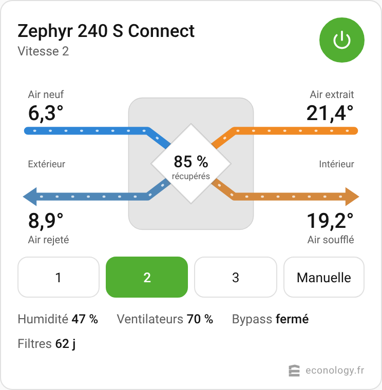
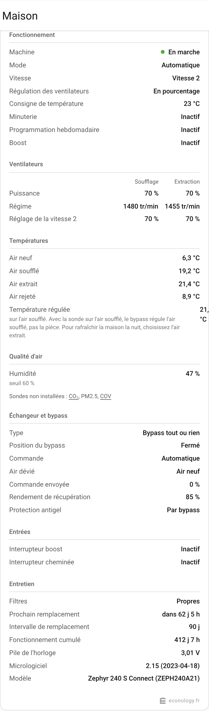

<p align="center">
  <a href="https://www.econology.fr/?utm_source=github&utm_medium=readme&utm_campaign=vents_a21">
    
  </a>
</p>

# VMC double flux ECONOPRIME Connect dans Home Assistant

Pilotez et surveillez votre VMC double flux **ECONOPRIME Connect** (automate VENTS A21) depuis Home Assistant : températures des quatre flux d'air, rendement de récupération, vitesses, bypass, état des filtres, alarmes.

La liaison se fait en **Modbus TCP sur votre réseau local** (Wi-Fi ou Ethernet). Aucun cloud, aucun compte, aucun boîtier supplémentaire.

Une intégration proposée par [Econology](https://www.econology.fr/?utm_source=github&utm_medium=readme&utm_campaign=vents_a21), spécialiste français de la ventilation.

<p align="center">
  
</p>

## Machines compatibles

Toutes les VMC double flux ECONOPRIME équipées de l'automate A21 (gammes « Connect »), en vente sur econology.fr :

| Machine | Référence | Débit max | Fiche produit | Filtres de rechange |
|---|---|---|---|---|
| **Zephyr 240 S Connect** | ZEPH240A21 | 310 m³/h | [Voir](https://www.econology.fr/zephyr-240-connect-vmc-double-flux-zeph240a21-econoprime.html?utm_source=github&utm_medium=readme&utm_campaign=vents_a21) | [F7](https://www.econology.fr/filtre-f7-vmc-double-flux-zephyr-240-fzeph240f7-econoprime.html?utm_source=github&utm_medium=readme&utm_campaign=vents_a21) / [G4](https://www.econology.fr/filtre-g4-vmc-double-flux-zephyr-240-fzeph240g4-econoprime.html?utm_source=github&utm_medium=readme&utm_campaign=vents_a21) |
| **Zephyr 270 V Connect R** | 114800002 | 331 m³/h | [Voir](https://www.econology.fr/zephyr-270-connect-econoprime-vmc-double-flux-114800002.html?utm_source=github&utm_medium=readme&utm_campaign=vents_a21) | [F7](https://www.econology.fr/filtre-f7-zephyr-270-12300001-econoprime.html?utm_source=github&utm_medium=readme&utm_campaign=vents_a21) / [G4](https://www.econology.fr/filtre-g4-zephyr-270-12300002-econoprime.html?utm_source=github&utm_medium=readme&utm_campaign=vents_a21) |
| **Zephyr 550 V PH Connect R** | 114800003 | 720 m³/h | [Voir](https://www.econology.fr/vmc-double-flux-zephyr-550-v-ph-connect-r-econoprime-114800003.html?utm_source=github&utm_medium=readme&utm_campaign=vents_a21) | Sur la fiche produit |

Générations précédentes, toujours prises en charge :

| Machine | Référence | Débit max | Filtres de rechange |
|---|---|---|---|
| DF 180 Flat Connect | DFF18021 | 220 m³/h | [Voir](https://www.econology.fr/filtre-vmc-double-flux-df-180-econoprime.html?utm_source=github&utm_medium=readme&utm_campaign=vents_a21) |
| DF 270 Connect | DF27021 | 300 m³/h | [Voir](https://www.econology.fr/filtre-vmc-double-flux-df-270-econoprime.html?utm_source=github&utm_medium=readme&utm_campaign=vents_a21) |
| DF 350 Connect | DF35021 | 450 m³/h | [Voir](https://www.econology.fr/filtre-vmc-double-flux-df-350-econoprime.html?utm_source=github&utm_medium=readme&utm_campaign=vents_a21) |

Les autres machines à automate A21 (VENTS, Blauberg) utilisent la même table Modbus et devraient fonctionner : choisissez « Autre machine à automate A21 » à l'installation.

## Ce que vous obtenez

- **Une tuile prête à poser** sur votre tableau de bord, sans rien configurer : les quatre flux d'air colorés selon leur température réelle, le rendement de l'échangeur, la position du bypass (le flux dévié contourne l'échangeur sur le dessin), les boutons de vitesse et la marche/arrêt.
- **Une tuile « toutes les mesures »** pour ceux qui veulent tout voir : puissance, régime, débit et pression de chaque ventilateur, toutes les sondes, l'état de l'échangeur et des batteries, les entrées, l'entretien.
- **Les alarmes en clair** : les 46 codes de la machine sont traduits (« Défaut du ventilateur de soufflage », « Sonde de CO₂ non détectée »…), en distinguant les alarmes, qui arrêtent la machine, des simples avertissements.
- **Un rappel avant l'échéance des filtres**, 21 jours avant (délai réglable) puis à l'échéance. En option, la tuile ajoute le lien vers les bons filtres pour votre modèle.
- **Les réglages de l'application mobile** dans la page de l'appareil : puissance des ventilateurs de soufflage et d'extraction pour chaque vitesse, veille, boost et ses temporisations, seuils d'humidité et de qualité d'air, intervalle des filtres, minuterie, bascule hiver/été.
- **Toutes les mesures dans l'historique** et **toutes les commandes pour vos automatisations** : marche/arrêt, mode, vitesses 1 à 5 et vitesse manuelle, consigne, minuterie, programmation hebdomadaire, bypass forcé ouvert ou fermé pour le rafraîchissement nocturne.

### Seules vos options apparaissent

Les sondes d'humidité, de CO₂, de PM2.5 et de COV, l'entrée 0-10 V, les batteries de chauffage ou de refroidissement sont des options : toutes les machines ne les ont pas. L'intégration regarde ce qui est réellement monté et n'affiche que cela. Le reste existe, désactivé, dans la page de l'appareil : si vous ajoutez une sonde plus tard, activez son entité.

## Installation

### 1. Préparer la machine

1. Raccordez la machine à votre réseau avec son application mobile (Wi-Fi) ou par câble Ethernet.
2. Relevez son adresse IP, dans l'application ou dans la liste des appareils de votre box.
3. Dans votre box, réservez-lui cette adresse (bail DHCP statique) pour qu'elle ne change plus.

La machine n'accepte **qu'une seule connexion Modbus TCP** par interface réseau. Si une GTB ou une autre domotique l'interroge déjà en Modbus TCP, Home Assistant ne pourra pas s'y connecter. De son côté, Home Assistant n'occupe la connexion que le temps de chaque lecture.

### 2. Installer l'intégration avec HACS

[](https://my.home-assistant.io/redirect/hacs_repository/?owner=floecono&repository=ha-vents-A21&category=integration)

Ou à la main : HACS, menu à trois points, **Dépôts personnalisés**, collez `https://github.com/floecono/ha-vents-A21`, type **Intégration**, puis installez « ECONOPRIME Connect (VENTS A21) » et redémarrez Home Assistant.

Sans HACS : copiez le dossier `custom_components/vents_a21` dans le dossier `custom_components` de votre Home Assistant, puis redémarrez.

### 3. Ajouter la machine

[](https://my.home-assistant.io/redirect/config_flow_start/?domain=vents_a21)

Ou : **Paramètres**, **Appareils et services**, **Ajouter une intégration**, cherchez « ECONOPRIME ». Saisissez l'adresse IP et choisissez votre modèle. Le port (502) et l'adresse Modbus (1) sont dans les paramètres avancés, à ne modifier que si vous les avez changés sur la machine.

### 4. Poser les tuiles

Sur votre tableau de bord : crayon en haut à droite, **Ajouter une carte**, cherchez « VMC ». Deux tuiles sont proposées, et chacune trouve la machine toute seule. Rien à déclarer dans les ressources : elles sont livrées avec l'intégration.

| La machine d'un coup d'œil | Toutes les mesures |
|---|---|
|  |  |

En YAML :

```yaml
type: custom:vents-a21-card          # la machine d'un coup d'œil
```

```yaml
type: custom:vents-a21-details-card  # toutes les mesures
```

Avec plusieurs machines, précisez `device_id` (l'éditeur de la carte propose la liste) et, si vous voulez, `name` pour le titre.

#### Rappel des filtres et lien de commande

La tuile principale affiche un rappel quand les filtres arrivent à échéance. Deux options se règlent dans l'éditeur de la tuile, ou en YAML :

- **`filter_reminder_days`** : nombre de jours avant l'échéance à partir duquel le rappel s'affiche. 21 par défaut ; avec 0, il n'apparaît qu'une fois l'échéance atteinte.
- **`filter_link`** : ajoute au rappel un lien **Commander les filtres**, qui mène directement aux filtres de votre modèle sur econology.fr. Désactivé par défaut.

```yaml
type: custom:vents-a21-card
filter_reminder_days: 30
filter_link: true
```

## Réglages

Dans **Paramètres**, **Appareils et services**, ouvrez la machine : le bloc **Configuration** reprend les réglages de l'application mobile.

- **Vitesses** : pourcentage du ventilateur de soufflage et d'extraction pour la veille et pour chaque vitesse. Sur une machine réglée en débit constant ou en pression constante, ce sont des m³/h ou des pascals qui sont proposés à la place.
- **Boost** : vitesses de soufflage et d'extraction, temporisations de démarrage et d'arrêt.
- **Minuterie** : vitesse, durée, température.
- **Qualité d'air** : seuils d'humidité, de CO₂, de PM2.5 et de COV, selon les sondes montées.
- **Filtres** : intervalle de remplacement, remise à zéro du compteur.
- **Divers** : sonde servant à la régulation, température de bascule hiver/été, mode du bypass.

Les réglages du **menu ingénieur** existent aussi, désactivés par défaut : activation des sondes et des entrées, type de batterie, protection antigel, corrections des sondes de température, temporisations, coefficients des régulateurs. Activez seulement ceux dont vous avez besoin, ils agissent directement sur la machine.

Deux choses ne sont volontairement pas proposées : la remise aux réglages d'usine et le mot de passe du menu ingénieur.

## Alarmes et avertissements

Le capteur **Alarmes actives** donne le nombre de codes actifs, et ses attributs leur signification :

- `alarms` : les alarmes. La machine s'arrête et attend que vous appuyiez sur **Acquitter les alarmes** une fois la cause traitée.
- `warnings` : les avertissements. La machine continue de tourner, et l'avertissement disparaît seul quand sa cause disparaît.

Exemple de notification :

```yaml
automation:
  - alias: "VMC : prévenir en cas d'alarme"
    triggers:
      - trigger: state
        entity_id: binary_sensor.zephyr_240_s_connect_alarme
        to: "on"
    actions:
      - action: notify.notify
        data:
          title: "VMC"
          message: >
            {{ (state_attr('sensor.zephyr_240_s_connect_alarmes_actives', 'alarms')
                + state_attr('sensor.zephyr_240_s_connect_alarmes_actives', 'warnings')) | join(', ') }}
```

## Bon à savoir

- **Rendement de récupération** : calculé côté air neuf, (air soufflé − air neuf) ÷ (air extrait − air neuf). Il n'est affiché que lorsqu'il a un sens : machine en marche, bypass fermé, pas de batterie de chauffage en action, et au moins 5 °C d'écart entre intérieur et extérieur.
- **Intervalle de lecture** : 15 secondes par défaut, réglable dans les options de l'intégration.
- **Échangeur** : les machines ECONOPRIME ont un échangeur à plaques avec bypass. L'automate A21 sait aussi piloter un échangeur rotatif, qu'on trouve chez d'autres marques : l'intégration le reconnaît et adapte ses libellés, mais ce cas ne concerne pas la gamme.
- **Programmation hebdomadaire** : elle s'active et se désactive depuis Home Assistant. Ses créneaux se règlent pour l'instant dans l'application mobile.
- **Automatisations Home Assistant** : vous pouvez aussi vous passer de la programmation de la machine et tout piloter par des automatisations, par exemple changer de vitesse selon l'heure, la présence, l'humidité ou le CO₂, lancer la minuterie pendant la douche ou être prévenu quand les filtres sont à remplacer. Dans ce cas, désactivez la programmation hebdomadaire de la machine, pour que les deux ne se contredisent pas.
- **Horloge** : le bouton « Mettre l'horloge à l'heure » est désactivé par défaut tant qu'il n'a pas été validé sur machine.
- **Assistance** : dans la page de l'intégration, menu à trois points, **Télécharger les diagnostics**. Le fichier contient les registres bruts de la machine, sans son adresse IP : joignez-le à votre demande.

## Sécurité du réseau

Le protocole Modbus TCP ne prévoit ni mot de passe ni chiffrement : tout appareil présent sur le même réseau que la machine peut la lire et la piloter. Ce n'est pas propre à cette intégration, c'est le fonctionnement du protocole. La protection se fait donc par le réseau et par Home Assistant.

- **Ne redirigez jamais le port 502 vers Internet** sur votre box ou votre routeur.
- **Pilotez à distance en passant par Home Assistant** (son accès distant ou un VPN), jamais en ouvrant un accès direct à la machine.
- **Protégez Home Assistant** : c'est lui qui porte les comptes et les mots de passe. Activez la double authentification.
- **Invités** : faites-les passer par le Wi-Fi invité de votre box, qui est isolé du réseau où se trouve la machine.
- **Pour aller plus loin, un réseau à part pour les appareils sans authentification** : si votre routeur le permet, regroupez dans un VLAN dédié la machine et vos autres équipements qui se pilotent sans mot de passe (Modbus, objets connectés), et n'autorisez que Home Assistant à les joindre. Un ordinateur ou un téléphone du réseau principal ne peut alors plus les atteindre directement. La marche à suivre est détaillée ci-dessous.

### Installations professionnelles ou réseau partagé

C'est la méthode des gestions techniques de bâtiment : on ne sécurise pas le Modbus lui-même, on l'enferme dans une zone technique, et les personnes s'identifient sur la supervision. Ici, Home Assistant joue le rôle de la supervision.

- **Réseau technique séparé** : placez la machine dans un VLAN dédié, distinct des postes de travail et du Wi-Fi.
- **Pare-feu en liste blanche** : bloquez tout entre les réseaux, et n'ouvrez qu'un flux, de Home Assistant vers la machine, en TCP sur le port 502.
- **Un seul maître** : Home Assistant est le seul à interroger la machine en Modbus. Les utilisateurs passent par lui, avec leurs comptes et leurs droits.
- **Accès distant des mainteneurs** : par un VPN vers Home Assistant, jamais par un accès direct à la machine.
- **Sortie Internet de la machine** : bloquez-la si vous n'utilisez pas le pilotage à distance de l'application mobile.
- **Passerelle RS485 vers Ethernet** : si la machine est raccordée par une passerelle Modbus, celle-ci n'authentifie pas davantage ses clients. Placez-la dans le même réseau technique et changez son mot de passe d'administration.

## État de la version 0.2.2

L'intégration est écrite d'après la table Modbus officielle de l'automate A21 (VENTS, document V55-8-1EN-02) et la notice de l'application DF Connect pour la signification des codes d'alarme. Elle est vérifiée contre un simulateur de la machine, par une suite de tests automatiques et par un essai dans une instance Home Assistant. Elle n'a pas encore été validée sur une machine réelle : vos retours sont les bienvenus, [ouvrez un ticket](https://github.com/floecono/ha-vents-A21/issues) en joignant les diagnostics.

## Besoin de filtres, d'une sonde, d'un conseil ?

Filtres de rechange, sondes CO₂ et hygrométriques, batteries de préchauffage, conduits et bouches : tout est sur **[econology.fr](https://www.econology.fr/?utm_source=github&utm_medium=readme&utm_campaign=vents_a21)**, avec une équipe qui connaît ces machines.

## Pour les développeurs

```bash
pip install -r requirements_test.txt
pytest
```

`tests/simulator.py` est un simulateur Modbus TCP de l'automate A21, sans dépendance. Lancé seul (`python tests/simulator.py --port 5020`), il permet d'essayer l'intégration sans machine. Le client Modbus est embarqué dans l'intégration (`modbus.py`) pour ne dépendre d'aucune bibliothèque externe.

L'ordre des octets des registres composés (minuteries, version du micrologiciel) reprend celui documenté par le projet [pybls21](https://github.com/jvitkauskas/pybls21) pour l'automate Blauberg S21, de la même famille que l'A21.

## Licence

Copyright © 2026 Econology.

Cette intégration est un logiciel libre, distribué sous la licence [GNU GPL version 3](LICENSE) : vous pouvez l'utiliser, la modifier et la redistribuer, à condition de conserver cette mention et de publier vos versions modifiées sous la même licence. Elle est fournie sans aucune garantie.

La licence porte sur le code. Elle ne donne aucun droit sur les noms et logos Econology et ECONOPRIME.
